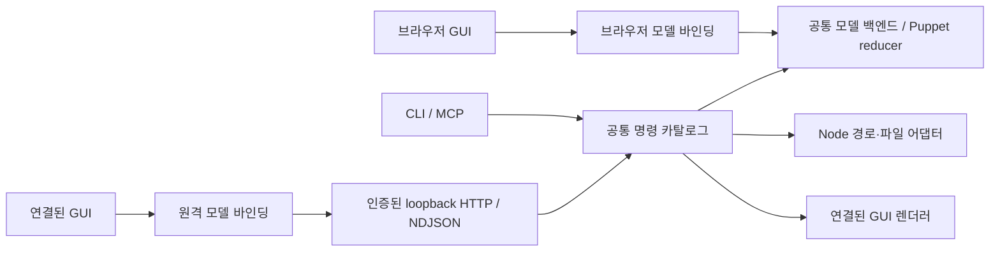

# Poffo 백엔드

Node와 브라우저가 문서·이력·편집 로직을 공유하고, 파일·PNG·렌더 I/O를 환경별 어댑터로 연결한다.

## 문서와 이력

[공통 모델 백엔드](create-model-backend.ts#L11)가 유일한 이력을 소유한다. [브라우저 로컬 바인딩](../model/create-model-session.ts#L18)은 이를 Solid에 연결한다. [원격 바인딩](browser/create-remote-model-session.ts#L28)은 편집 중 화면을 투영하고 명령을 순서대로 보내며, 실제 완료 응답과 스트림을 받아 확정한다. 원격 GUI가 별도의 undo 이력을 만들지 않는다.

[명령 서비스](create-command-service.ts#L26)는 카탈로그·검증·실행·제한된 재전송 기록을 공유한다. 문서 편집·파일·렌더 연산은 같은 서비스에 연결된다. 파일 접근과 렌더는 주입하는 능력이며 공통 모델에 Node나 DOM을 추가하지 않는다.

## 환경별 I/O

- PSD 해석·레이어·마스크·메시 생성은 Puppet의 [공통 변환기](../../../../packages/puppet/src/converter/import-psd-source.ts#L10)에서 수행한다. 이름·크기·바이트 읽기와 PNG 인코더를 주입한다.
- Node는 [경로 입력](node/read-document-path.ts#L1)과 [PNG 인코더](node/encode-psd-texture.ts#L5)를 제공한다. 브라우저는 [File/Worker 입력](../../../../packages/puppet/src/editor/import-psd.ts#L12)과 브라우저 인코더를 사용한다.
- [파일 저장](node/write-document-path.ts#L20)은 같은 디렉터리의 임시 파일을 완성·동기화한 뒤 확정한다. overwrite를 지정하지 않으면 기존 파일을 보존한다. 경로 접근은 workspace와 실제 symlink 대상을 검사한다.
- [Node 직렬화 어댑터](node/serialize-document-file.ts)는 공통 Poffo 컨테이너에 비동기 네이티브 Brotli를 주입한다. 브라우저는 Worker/WASM에서 저장 속도에 맞춘 압축 설정을 사용한다. 두 경로 모두 원본 바이트를 보존하며 Node에서는 압축이 이벤트 루프를 막지 않는다.
- [Node 호스트](node/start-node-host.ts#L1)는 단일 모델, 복구 저장, 인증, 클라이언트 수명과 GUI 연결을 구성한다. 최초 연결은 유한한 JSON snapshot으로 전달하고 이후 변경은 NDJSON delta로 전달한다. snapshot 로딩 중 들어온 이벤트는 sequence에 따라 연결해 큰 문서에서도 변경을 잃지 않는다. 연결 종료 시 그 클라이언트가 소유한 미완료 트랜잭션만 해제한다.
- 종료 시 접수한 명령과 복구 저장을 마친 뒤 미완성 HTTP 연결을 정리한다. 대기 중인 렌더는 취소하며, 접수한 편집이 문서를 변경했다면 일반 종료의 저장 상태를 다시 확인한다. [종료 회귀 검증](node/__tests__/start-node-host.shutdown.integration.ts)과 [설치 CLI 대조](../../validation/runtime/README.md)를 함께 유지한다.
- [연결 어댑터](browser/connect-model-host.ts)는 정상 연결 뒤 이벤트 응답 읽기가 중단되면 새 스트림과 snapshot으로 다시 동기화한다. 같은 sequence는 재적용하지 않아 저장 중인 문서의 동일성을 유지한다. 재연결 초기화가 끝난 뒤 명령을 보내며, 이미 보낸 편집 명령을 자동으로 재실행하지 않는다. 새 연결 실패와 잘못된 이벤트는 연결 오류로 보고한다.
- [렌더 어댑터](browser/render-document.ts#L24)는 별도 플레이어에서 요청 포즈를 그린 뒤 `onAfterRender`에서 RGBA를 읽는다. WebGL2에서는 같은 크기의 RGBA8 버퍼로 MSAA를 명시적으로 resolve하고, [공통 PNG 인코더](encode-frame-png.ts#L13)로 알파 형식과 행 방향을 변환한다. 현재 GUI 포즈를 수정하지 않는다. 물리는 끈 상태의 프레임 캡처이며 연속 물리 재생 검증은 별도다.

PSD 인코더별 압축 바이트와 완전 투명한 픽셀의 RGB는 달라질 수 있다. 출력 비교에서는 바이트 일치와 문서·화면 픽셀의 의미 일치를 구분한다.

## 실행과 검증

CLI 사용법·제작 레시피·MCP 연결과 현재 한계는 [CLI 설명](../cli/README.md)에 있다. 제작 지침은 [Poffo 제작 스킬](../../skills/poffo-authoring/SKILL.md)에 둔다.

- Node 통합 테스트: `pnpm exec vitest run --config apps/poffo/vitest.backend.config.ts`
- 실제 GUI·CLI·MCP·렌더·저장/재로드와 개발 모드·레시피 재개: `pnpm exec playwright test --config apps/poffo/playwright.backend.config.ts`

Node 테스트는 빌드된 Puppet public entry를 사용한다. 먼저 Puppet을 빌드한다. 브라우저 E2E는 Poffo도 빌드한 뒤 실행한다. 소스 모듈 검사, jsdom, 실제 Chromium 검증은 서로 다른 증거다.
